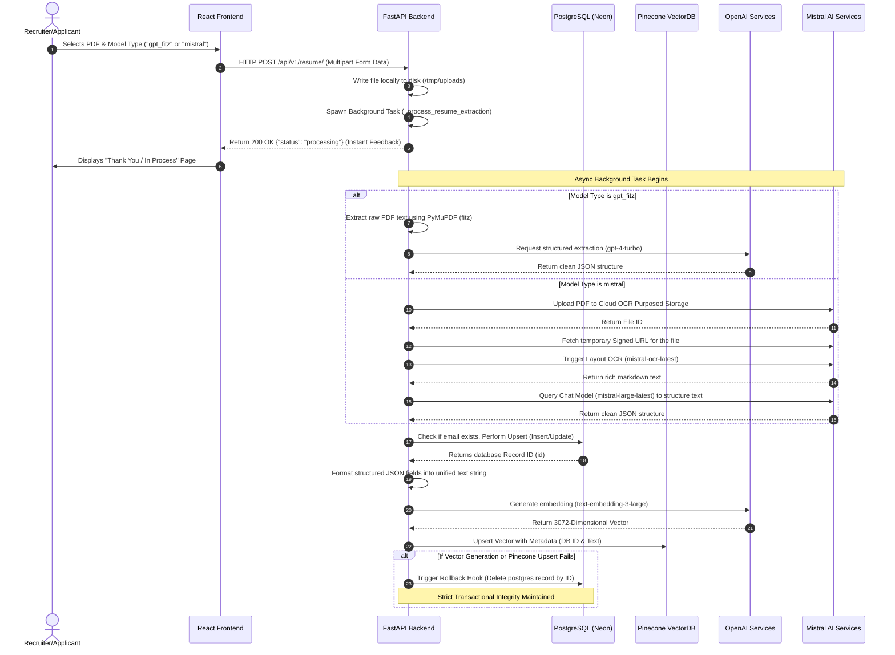
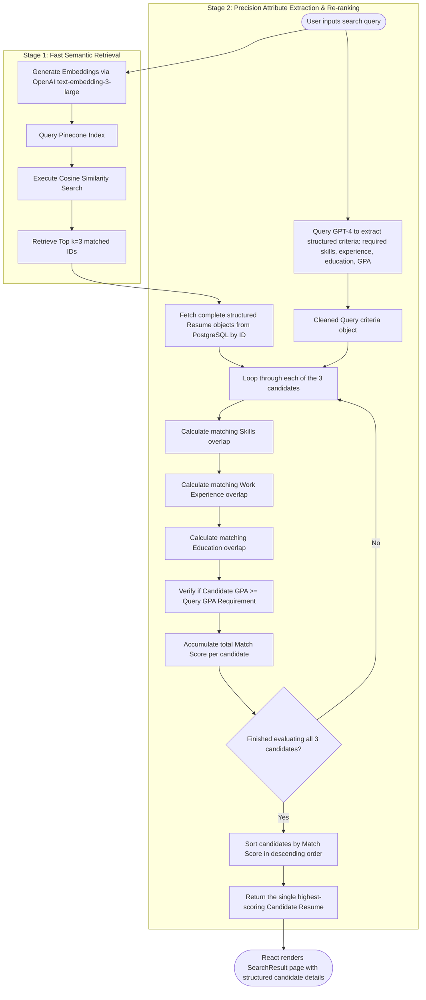

# ResumeParserAI: Comprehensive Technical Documentation & Interview Preparation Guide

This guide is a highly detailed, comprehensive manual for **ResumeParserAI**, designed to help you thoroughly understand every layer of the system and confidently navigate any technical interview. 

---

## 🗺️ Table of Contents
1. [Complete Project Overview](#-complete-project-overview)
2. [Detailed Architecture Explanation](#-detailed-architecture-explanation)
   * [Technology Stack Used](#1-technology-stack-used)
   * [Tech Stack Rationale & Industry Alternatives](#11-tech-stack-rationale--industry-alternatives)
   * [Database Design (PostgreSQL Relational Schema)](#2-database-design-postgresql-relational-schema)
   * [API Routing and Contracts](#3-api-routing-and-contracts)
3. [System Flowcharts & Diagrams](#-system-flowcharts--diagrams)
4. [Step-by-Step Internal Working](#-step-by-step-internal-working)
5. [Module-wise Deep Dive](#-module-wise-deep-dive)
6. [Comprehensive Interview Preparation Section (Mandatory & Scenario Questions)](#-comprehensive-interview-preparation-section)
7. [Technical Challenges & Architectural Trade-offs](#-technical-challenges--architectural-trade-offs)
8. [System Limitations & Future Enhancements](#-system-limitations--future-enhancements)

---

## 📋 Complete Project Overview

### 1. Purpose of the Project
**ResumeParserAI** is an enterprise-grade intelligent resume parsing, retrieval, and ranking system. It utilizes modern Large Language Models (LLMs), Optical Character Recognition (OCR), and vector embeddings to ingest unstructured PDF resumes, parse them into schema-compliant relational data, and enable natural language semantic search. Recruiters can query the system with highly descriptive prompts (e.g., *"Hiring a senior React engineer with 5+ years of experience, strong background in Machine Learning, and a GPA above 3.5"*) and receive precise, rank-ordered candidate profiles.

### 2. The Problem Statement
Traditional **Applicant Tracking Systems (ATS)** suffer from three severe limitations:
* **The Unstructured Data Trap:** Resumes are uploaded in diverse formats—multi-column layouts, graphics, scanned text, tables, and PDFs with differing typography. Simple text extractors often fail to maintain reading order, scrambling critical context.
* **The Semantic Keyword Gap:** Traditional search engines rely on exact keyword matching (Boolean searches). If a recruiter searches for *"Machine Learning Engineer"*, they will miss a stellar candidate whose resume only lists *"Deep Learning, PyTorch, Transformer Models, Neural Networks"* because the exact phrase was not present.
* **No Intelligent Structuring or Re-ranking:** Standard search results do not validate structural criteria like minimum GPA, specific certification bodies, or job durations relative to the context of the search prompt.

### 3. Objectives and Goals
* **Multi-Modal Parsing Pipeline:** Create two separate ingestion pipelines:
  1. **High-Accuracy Contextual Parsing:** PyMuPDF (`fitz`) text extraction paired with OpenAI `gpt-4-turbo`.
  2. **High-Fidelity Visual Layout Ingestion:** Mistral OCR (`mistral-ocr-latest`) markdown extraction paired with `mistral-large-latest` for layout-heavy or scanned documents.
* **Hybrid Two-Stage Search (Retrieve-and-Rerank):** Combine fast semantic vector retrieval (Pinecone + OpenAI Embeddings) with strict grammar-based matching (GPT-4 prompt attribute parsing + Python attribute intersection scoring).
* **Asynchronous Background Processing:** Enable non-blocking, highly responsive upload flows using FastAPI's background task executors.
* **Clean Relational Storage:** Store structured entities (JSON-based skills, education arrays, work history) in PostgreSQL to support rapid, direct lookups.

### 4. Real-World Use Case
This application is designed for:
* **Corporate Human Resource Departments:** Streamlining massive high-volume applicant screening.
* **Staffing & Technical Recruiting Agencies:** Allowing non-technical recruiters to query candidate databases using plain natural language rather than constructing complex Boolean strings.
* **Freelance Matching Platforms:** Instantly finding matching developers, designers, or writers by comparing project descriptions directly against historical developer resumes.

---

## 🏗️ Detailed Architecture Explanation

ResumeParserAI is designed with a modern decoupled client-server architecture consisting of a **React SPA frontend**, a **FastAPI backend microservice**, **Neon Serverless PostgreSQL** (relational database), and **Pinecone** (vector database).

```
                      +-------------------+
                      |   React Frontend  |
                      |   (Vite / CRA)    |
                      +---------+---------+
                                |
                                | REST APIs (JSON / Multipart Form)
                                v
                      +-------------------+
                      |  FastAPI Backend  | <----+ Request Process Timing
                      +----+---------+----+      | & Global Error Handling
                           |         |
      +--------------------+         +---------------------+
      | Relational Queries                                 | Vector Operations
      v (SQLAlchemy ORM)                                   v (Pinecone Client)
+-----+---------------+                            +-------+-----------+
| PostgreSQL (Neon)   |                            | Pinecone VectorDB |
| - Structured Resumes|                            | - 3072D Embeddings|
+---------------------+                            +-------------------+
      ^                                                    ^
      |                                                    |
      | Text/Markdown Structuring                          | Text Embeddings
      v                                                    v
+-----+----------------------------------------------------+-----------+
|                          AI Engine Layer                             |
|  - OpenAI GPT-4 Turbo (Structured JSON Parser)                       |
|  - OpenAI Text-Embedding-3-Large (3072 Dimensions)                   |
|  - Mistral OCR Latest (Document Ingestion)                           |
|  - Mistral Large Latest (Fallback Parser)                            |
+----------------------------------------------------------------------+
```

### 1. Technology Stack Used
* **Frontend:** React.js, Axios, React Router Dom, Vanilla CSS (Premium responsive styling).
* **Backend:** FastAPI (Python), Uvicorn (ASGI Server), SQLAlchemy (ORM), Pydantic (Data validation and settings management via `pydantic-settings`).
* **Databases:**
  * **Relational:** PostgreSQL (Neon Serverless, with `sslmode=require` configuration).
  * **Vector:** Pinecone Serverless.
* **AI & Document Processing:**
  * PyMuPDF (`fitz`) for local fast text extraction from digital PDFs.
  * Mistral OCR client (`mistralai`) for cloud-based layout-preserving optical character recognition.
  * OpenAI SDK (`openai`) for Chat Completions (GPT-4, GPT-4 Turbo) and Vector Embeddings (`text-embedding-3-large`).

### 1.1 Tech Stack Rationale & Industry Alternatives
Choosing the right set of technologies directly determines a system's throughput, scalability, operational costs, and development velocity. Below is a comprehensive architectural analysis detailing exactly **why** each core technology was chosen for ResumeParserAI, what **industry replacements** exist, and the **trade-offs** associated with those alternatives:

#### 💻 1. Frontend Framework: React.js (Vite SPA)
* **Why Chosen:** React's component-based reusability makes it simple to construct highly complex interactive UI elements (segmented skill badges, experience timelines, project detail grids). Client-Side Routing (`react-router-dom`) enables highly fluid, fast-loading transitions for a seamless, responsive user experience.
* **Industry Alternatives:** Next.js, Vue.js, or Svelte.
* **Trade-offs:** 
  * *Next.js*: Introduces Server-Side Rendering (SSR) and SEO benefits, but adds unnecessary server hydration complexity and hosting overhead for a closed-user recruiter tool.
  * *Vue.js / Svelte*: Simplifies state management and reduces boilerplate, but has significantly smaller component libraries and developer ecosystems.

#### 🎨 2. Styling Paradigm: Vanilla CSS
* **Why Chosen:** Grants absolute, fine-grained control over styling transitions, premium micro-animations, glassmorphism design tokens, and layouts without bloating raw production bundles or binding layouts to framework-specific utility structures.
* **Industry Alternatives:** TailwindCSS or Component Libraries (e.g., MUI, Ant Design, Bootstrap).
* **Trade-offs:** 
  * *TailwindCSS*: Promotes rapid prototyping, but pollutes JSX with long utility classes, makes maintenance harder, and limits unique visual customization.
  * *Component Libraries*: Speeds up standardized component creation, but leads to generic-looking interfaces and heavily bloated production bundle sizes.

#### ⚙️ 3. Backend Microservice: FastAPI (Python ASGI)
* **Why Chosen:** Offers exceptional throughput via Starlette/Uvicorn asynchronous event loops. Incredibly well-suited for heavily I/O-bound integrations (asynchronous HTTP calls to Mistral OCR and OpenAI). Spawns non-blocking asynchronous threads (`BackgroundTasks`) out-of-the-box, removing the immediate need for heavy task queues like Celery.
* **Industry Alternatives:** Django or Express.js (Node.js).
* **Trade-offs:** 
  * *Django*: Batteries-included but heavy, primarily synchronous, and introduces significant CPU/memory overhead.
  * *Express.js*: Ultra-fast and uses a unified JS codebase, but lacks native access to Python's robust AI/ML ecosystem (PyMuPDF, NumPy, SciPy, Pydantic).

#### 🗄️ 4. Relational Storage: PostgreSQL (Neon Serverless JSONB)
* **Why Chosen:** Stores complex nested structures (education lists, employment histories, grouped skill objects) directly inside binary JSONB columns without forcing slow, complex multi-table joins. Includes full ACID transaction compliance and scales computes dynamically.
* **Industry Alternatives:** MongoDB (NoSQL) or MySQL.
* **Trade-offs:** 
  * *MongoDB*: Seamless JSON document storage, but lacks transactional ACID reliability, robust SQL querying, and relational integrity.
  * *MySQL*: Strong relational performance, but lacks PostgreSQL's advanced JSONB indexings (GIN indices).

#### 📍 5. Vector Indexing: Pinecone Serverless
* **Why Chosen:** Operates as a highly scalable cloud-native SaaS database, providing sub-second semantic search latencies and robust metadata filtering without operational cluster maintenance overhead.
* **Industry Alternatives:** PGVector (PostgreSQL extension) or Qdrant / Weaviate.
* **Trade-offs:** 
  * *PGVector*: Combines relational and vector tables, avoiding dual-write problems. However, high-dimensional distance searches (3072D) are intensely CPU-heavy, degrading transactional database speed under high query volume.
  * *Qdrant / Weaviate*: Highly specialized and performant, but requires manual hosting and server infrastructure maintenance.

#### 📄 6. Local Document Parser: PyMuPDF (`fitz`)
* **Why Chosen:** PyMuPDF runs highly optimized C-compiled extraction code (up to 10x faster than pure-Python extractors), delivering rapid, reliable digital PDF reading on local processes.
* **Industry Alternatives:** PyPDF / PDFMiner or LangChain Document Loaders.
* **Trade-offs:** 
  * *PyPDF / PDFMiner*: Slower extraction, and fails to expose granular bounding box block coordinates.
  * *LangChain*: Simple API but introduces heavy bloated dependencies and less low-level coordinate control.

#### 👁️ 7. Visual Document Parser: Mistral OCR (`mistral-ocr-latest`)
* **Why Chosen:** Combines visual canvas analysis and Optical Character Recognition to successfully map tabular resumes and low-quality scans into structured, visually preserved Markdown.
* **Industry Alternatives:** Tesseract OCR (Open Source) or AWS Textract.
* **Trade-offs:** 
  * *Tesseract OCR*: Free and offline, but requires complex manual layout preprocessing and suffers from high visual noise failures.
  * *AWS Textract*: Extremely powerful, but significantly higher cost-per-page and longer API response times.

#### 🧠 8. AI LLM Core: OpenAI GPT-4 Turbo
* **Why Chosen:** Provides industry-leading zero-shot schema compliance, extremely high reasoning ability, and high precision when performing semantic criteria parsing on natural language recruiter searches.
* **Industry Alternatives:** Local Open-Source LLMs (e.g., Llama 3 / Mistral 7B) or Anthropic Claude.
* **Trade-offs:** 
  * *Llama 3 / Mistral 7B*: Complete data privacy and zero API costs, but suffers from frequent JSON syntax parsing crashes and has reduced reasoning context capability.
  * *Claude*: Exceptional reasoning, but has different API SDK payloads and higher cost-per-token for structured extraction compared to GPT-4 Turbo.

### 2. Database Design (PostgreSQL Relational Schema)
Structured metadata extracted from resumes is mapped to a highly normalized JSON-based structure in PostgreSQL. This allows deep nested structures (like a list of past companies, project descriptions, or grouped skill categories) to be stored without requiring excessively complex relational tables.

#### Table: `resume`
| Column Name | SQLAlchemy Type | Pydantic Type | Constraints | Description |
|---|---|---|---|---|
| `id` | `Integer` | `int` | Primary Key, Index | Autoincrementing unique identifier |
| `name` | `String` | `str` | Not Null | Candidate's extracted full name |
| `email` | `String` | `str` | Unique, Not Null | Candidate's email (serves as unique business key) |
| `phone_number`| `String` | `Optional[str]`| Nullable | Extracted contact number |
| `skills` | `JSON` | `Dict[str, Any]`| Not Null | Grouped skills (e.g., `{"Languages": ["Python"], "Cloud": ["AWS"]}`) |
| `work_experience`| `JSON` | `List[Dict]` | Nullable | Array of employment history (Role, Company, Duration, Description) |
| `education` | `JSON` | `List[Dict]` | Not Null | Array of degrees, majors, colleges, and years |
| `certifications`| `JSON` | `List[Dict]` | Nullable | Array of certifications |
| `projects` | `JSON` | `List[Dict]` | Not Null | Personal or professional projects |
| `gpa` | `String` | `Optional[str]`| Default "0" | Grade Point Average |
| `model_type` | `String` | `str` | Not Null | The pipeline model used (`gpt_fitz` or `mistral`) |

### 3. API Routing and Contracts
The application exposes standard REST endpoints prefixed with `/api/v1`:

* **`POST /api/v1/resume/`** (Multipart Form Upload)
  * **Payload:** `file` (Binary PDF), `model_type` (String enum: `gpt_fitz` or `mistral`).
  * **Response (Immediate Async acknowledgment):**
    ```json
    {
      "status": "processing",
      "message": "Your resume is being processed. This may take a few moments."
    }
    ```
* **`POST /api/v1/search-resume/`** (RAG Candidate Query)
  * **Payload:** 
    ```json
    {
      "user_prompt": "Looking for a 4.0 GPA Python backend dev"
    }
    ```
  * **Response:** A complete structured candidate `ResumeResponse` object containing their full profile, contact info, and structural records.
* **`GET /api/v1/resume/{resume_id}`** (Detail Fetch)
  * **Response:** Structured resume object matched by primary key.

---

## 📊 System Flowcharts & Diagrams

### 1. System Ingestion Pipeline (Upload & Extract Flow)
This diagram illustrates the step-by-step lifecycle of uploading a resume, showing how the frontend, FastAPI, background workers, and AI services interact to process the document.



#### **🔍 Step-by-Step Ingestion & Extraction Flow Breakdown:**
* **1. Initiate Upload**: The user (recruiter/applicant) selects a PDF resume and the parsing model strategy (either "gpt_fitz" or "mistral") on the React Frontend.
* **2. Multipart Transfer**: The Frontend sends a multipart form POST request (`/api/v1/resume/`) containing the file and the chosen model strategy to the FastAPI Backend.
* **3. File Buffering**: The backend intercepts the file and writes it locally to a temporary disk path (`/tmp/uploads`) for quick offline access.
* **4. Background Delegation**: The backend spawns an asynchronous background task (`_process_resume_extraction`) to handle the parsing without blocking the user.
* **5. Instant User Handshake**: The backend immediately returns a `200 OK` response with `{"status": "processing"}` to the frontend.
* **6. Seamless UI Transition**: The frontend redirects the user to the "Thank You / Processing" screen, providing a fast and fluid user experience.
* **7. Asynchronous Extraction Routes**: The background task begins processing the file using the selected strategy:
  * **`gpt_fitz` Path**: The backend opens the PDF using **PyMuPDF (fitz)**, extracts the raw text page-by-page, and joins the lines with newlines. This text is then passed to **OpenAI's GPT-4 Turbo** for structured JSON extraction.
  * **`mistral` Path**: The PDF is uploaded to Mistral's file store, a temporary signed URL is retrieved, and **`mistral-ocr-latest`** is triggered to run high-fidelity visual OCR (returning rich markdown). This markdown is then parsed into structured JSON by **`mistral-large-latest`**.
* **8. Relational Upsert**: The structured JSON data is saved to PostgreSQL (Neon). The system checks if the email already exists: if yes, it updates the existing record; if no, it creates a new record.
* **9. Record ID Resolution**: PostgreSQL returns the unique relational record ID (`id`) back to the backend.
* **10. Embedding Ingress**: The backend compiles the structured fields into a clean, uniform textual format to avoid visual PDF noise and sends it to OpenAI's **`text-embedding-3-large`** to generate a **3072-dimensional vector embedding**.
* **11. Vector Store Update**: The 3072-dimensional vector is upserted into the **Pinecone VectorDB** mapped directly to the PostgreSQL record ID.
* **12. Transactional Rollback Hook**: If vector generation or the Pinecone upsert fails, a transactional rollback hook deletes the newly created PostgreSQL record, ensuring strict transactional integrity between relational and vector stores.

### 2. Complete Search Execution Flow (Hybrid Two-Stage RAG Pipeline)
This diagram details the advanced two-stage search method, visualizing how the system performs semantic search followed by strict granular re-ranking.



#### **🔍 Step-by-Step Search Execution Flow Breakdown:**
* **1. Query Submission**: The recruiter inputs a natural language search query (e.g. *"5+ years Python developer with a 3.8 GPA"*).
* **2. Query Vectorization**: The backend sends the query to OpenAI's **`text-embedding-3-large`** to generate a corresponding high-dimensional embedding vector.
* **3. Stage 1 (Fast Semantic Retrieval)**:
  * The backend queries the **Pinecone Index** using the query embedding.
  * A **Cosine Similarity** search is performed across all stored resume vectors.
  * The system retrieves the top **$k=3$ matched candidate IDs** that are semantically closest to the query.
* **4. Database Hydration**: Using the top 3 candidate IDs, the backend fetches the complete structured resume records from the **PostgreSQL (Neon)** database.
* **5. Parallel Criteria Extraction**: In parallel with candidate retrieval, the backend queries **GPT-4** with the original natural language query to parse and extract the structured criteria requirements (e.g., specific skills, years of experience, education majors, and GPA thresholds).
* **6. Stage 2 (Algorithmic Intersection & Re-ranking)**:
  * The backend runs a precise Python intersection loop over the hydrated candidate resumes and the extracted criteria.
  * **Skills Overlap**: Calculates the intersection of the candidate's skills dictionary/list against the query skills.
  * **Work Experience Match**: Scans job titles, company names, and descriptions for matching terms.
  * **Education Match**: Cross-references degrees, universities, and certificates.
  * **GPA Threshold Guard**: Assesses whether the candidate meets the exact GPA requirement (e.g., candidate GPA >= query GPA).
* **7. Match Score Accumulation**: The overlap scores are accumulated for each candidate.
* **8. Final Sorting & UI Rendering**: The candidates are sorted by their accumulated match score in descending order, and the single highest-scoring profile is returned to the frontend. The **React Frontend** beautifully renders the detailed structured profile on the results page.

---

## ⚙️ Step-by-Step Internal Working

Let's dissect exactly how the pipelines run underneath the hood.

### 🚀 1. The Write Pipeline: Resume Upload & Ingestion
1. **User Action:** The recruiter uploads a PDF file on the UI, selects a parsing strategy (`gpt_fitz` or `mistral`), and submits.
2. **File Buffering:** FastAPI's `upload_resume` handler intercepts the file stream, saves it locally inside `/tmp/uploads`, and creates an asynchronous FastAPI `BackgroundTask` passing the absolute file path, the database session, and the requested model type.
3. **Immediate Handshake:** To maximize UI performance, the HTTP thread is released instantly with a status response `{"status": "processing"}`. The browser redirects the user to `/thank-you`.
4. **Contextual Text Ingestion (Background Thread):**
   * **GPT-4 Turbo Strategy:** The local engine opens the PDF using **PyMuPDF (`fitz`)**, loops through every page, extracts raw text strings using `page.get_text("text")`, and joins them with newlines. This text is appended to a highly descriptive prompt instructing `gpt-4-turbo` to extract precise JSON mapping to the database model schema (Name, Email, Skills, Experience, Education, GPA).
   * **Mistral OCR Strategy:** Designed for low-quality or visual documents. The PDF is first uploaded to Mistral's file store via `client.files.upload` with `purpose="ocr"`. A signed document URL is fetched, and `mistral-ocr-latest` executes OCR, outputting structurally preserved markdown. This markdown text is then passed to `mistral-large-latest` with a parsing schema prompt to output structured JSON.
5. **Relational Ingest & Business Key Upsert:** The backend attempts to write the structured JSON to PostgreSQL. It checks if the candidate exists via the unique constraint `email`. 
   * If **Yes:** It performs an **in-place update** (updating phone number, skills, projects, GPA, etc.), overwriting obsolete records.
   * If **No:** It inserts a **new** record into the table.
6. **Unified Document Formatting:** The system compiles the structured fields back into a clean, uniform textual format (`_prepare_generation_text`). Doing so ensures that the embedding represents the exact details saved in our SQL database, devoid of visual PDF noise or random spacing.
7. **High-Dimensional Vectorization:** The compiled text is passed to OpenAI's `text-embedding-3-large` API to generate a **3072-dimensional vector** representing its deep semantic meaning.
8. **Vector Store Ingress:** The backend connects to Pinecone. It queries the vector database using a semantic search of the new vector to see if a vector with this relational database ID already exists. 
   * If **Yes:** It fetches the existing vector's unique UUID and calls an `upsert` to update the vector and metadata.
   * If **No:** It generates a new unique `uuid.uuid4()`, upserting a fresh vector entry.
   * **Metadata Payload:** `{"text": formatted_text, "id": str(db_id)}`.
9. **Strict Cleanup Transactional Hook:** If vector generation fails (e.g. OpenAI rate limit) or Pinecone upsert fails, a `try-except` block calls `_delete_resume_from_db`. This deletes the newly created relational record in PostgreSQL, maintaining strict transactional consistency across databases.

---

### 🔍 2. The Read Pipeline: Natural Language Candidate Search
The search architecture uses a **Two-Stage Retrieve-and-Rerank (RAG)** pipeline.

#### 📍 Stage 1: Vector-Based Semantic Retrieval (Coarse Filtering)
1. The search string is posted to `/api/v1/search-resume/`.
2. The query is converted into a 3072-dimensional embedding using OpenAI `text-embedding-3-large`.
3. The server runs a Cosine Similarity similarity query against the Pinecone index:
   ```python
   results = index.query(vector=user_embedding, top_k=3, include_metadata=True)
   ```
4. This instantly scans millions of resumes and returns the IDs of the top **$k=3$ matches** that are semantically similar.

#### 📍 Stage 2: Prompt Attribute Parsing & Re-ranking (Fine-Grained Match)
1. **Parallel Extraction:** While candidate records are fetched, the system sends the raw search query (e.g. *"5+ years Python dev with a 3.8 GPA"*) to GPT-4 to convert it into a structured query criteria object:
   * **Required Skills:** `["Python"]`
   * **Experience Terms:** `["Senior", "Developer"]`
   * **GPA Threshold:** `"3.8"`
2. **PostgreSQL Hydration:** The backend loads the full relational candidate resumes for the matching 3 IDs from PostgreSQL.
3. **Algorithmic Intersection Scoring:** A precise algorithmic scoring function runs in Python to cross-check each candidate:
   * **Skills Overlap:** Counts how many of the query's required skills intersect with the candidate's skills dictionary (supports both list and dictionary categorization).
   * **Work Experience Match:** Scans job titles, company names, and employment descriptions, incrementing the score for every match with query experience terms.
   * **Education & Certifications Match:** Checks for overlap in degrees, universities, and certification names.
   * **GPA Threshold Guard:** Evaluates `int(query_gpa) <= int(candidate_gpa)`. If the candidate does not meet the minimum GPA limit, they are disqualified or scored accordingly.
4. **Sort and Return:** The 3 hydrated candidates are sorted by their accumulated overlap score in descending order. The candidate ranked **first** (the absolute best fit) is returned as a single JSON object.
5. **UI Rendering:** The React frontend maps the JSON payload to structured components, rendering an impressive profile cards interface showing experience timelines, segmented skill tags, project details, and certifications.

---

## 📦 Module-wise Deep Dive

Let's examine the structure of each folder and source code file.

### 1. Backend Core Config

#### 📂 [database.py](file:///c:/Users/abhis/OneDrive/Documents/Projects/Resume-Parser/backend/database.py)
* **Responsibilities:** Sets up the SQLAlchemy database engine, session makers (`SessionLocal`), and manages database setup.
* **Key Implementation Detail:** Includes `ensure_database_exists` which hooks into the Neon database instance to programmatically create the target database if it is absent. Uses `Base.metadata.create_all(bind=engine)` to dynamically create the SQL tables based on SQLAlchemy schemas.

#### 📂 [models.py](file:///c:/Users/abhis/OneDrive/Documents/Projects/Resume-Parser/backend/models.py)
* **Responsibilities:** Declares the relational table blueprint mapped to Python classes.
* **Key Implementation Detail:** Maps complex structural components of the resume (like Skills, Work Experience, Education, Certifications, and Projects) using SQLAlchemy `JSON` columns. This provides PostgreSQL's rich JSONB capabilities, letting developers store deep nested structures without building 6 different join tables.

#### 📂 [schemas.py](file:///c:/Users/abhis/OneDrive/Documents/Projects/Resume-Parser/backend/schemas.py)
* **Responsibilities:** Declares Pydantic models for request validation and response serialization.
* **Key Implementation Detail:** Declares `ResumeBase`, `ResumeCreate` and `ResumeResponse`. Sets `orm_mode = True` on the Pydantic configuration to enable seamless conversion from SQLAlchemy ORM entities to JSON payloads.

#### 📂 [main.py](file:///c:/Users/abhis/OneDrive/Documents/Projects/Resume-Parser/backend/main.py)
* **Responsibilities:** The ASGI application bootstrap file. Sets up CORS middleware, manages startup database migrations, establishes global exception hooks, and adds request timing headers.

---

### 2. Backend Routes

#### 📂 [routes/resume.py](file:///c:/Users/abhis/OneDrive/Documents/Projects/Resume-Parser/backend/routes/resume.py)
* **Responsibilities:** Orchestrates the REST controller endpoints.
* **Key Implementation Detail:** 
  * `upload_resume` intercepts file uploads, moves the files asynchronously to background tasks, and provides immediate HTTP status codes.
  * `process_resume_search_rag` manages the complete two-stage retrieval pipeline. It handles the interface between Pinecone, PostgreSQL, and the ranking algorithm.

---

### 3. Backend Utilities

#### 📂 [utils/embeddings.py](file:///c:/Users/abhis/OneDrive/Documents/Projects/Resume-Parser/backend/utils/embeddings.py)
* **Responsibilities:** Deals with everything related to Vector Embeddings and Pinecone.
* **Key Implementation Detail:** Includes `generate_embeddings` using OpenAI's `text-embedding-3-large` and `store_embedding` which safely runs an `upsert` vector routine in Pinecone. It queries Pinecone by metadata matching to ensure no duplicate vector records are written for the same applicant database ID.

#### 📂 [utils/gpt_fitz.py](file:///c:/Users/abhis/OneDrive/Documents/Projects/Resume-Parser/backend/utils/gpt_fitz.py)
* **Responsibilities:** Contextual PDF parsing pipeline.
* **Key Implementation Detail:** Utilizes PyMuPDF (`fitz`) to read text and clean formatting before passing it to `gpt-4-turbo` for structuring.

#### 📂 [utils/mistral.py](file:///c:/Users/abhis/OneDrive/Documents/Projects/Resume-Parser/backend/utils/mistral.py)
* **Responsibilities:** Multi-modal visual layout-preserving OCR parsing pipeline.
* **Key Implementation Detail:** Handles file upload to Mistral, requests OCR processing via `mistral-ocr-latest` to reconstruct complex scanned columns or tables into structured markdown, and passes it to `mistral-large-latest` for JSON structuring.

#### 📂 [utils/gpt_finder.py](file:///c:/Users/abhis/OneDrive/Documents/Projects/Resume-Parser/backend/utils/gpt_finder.py)
* **Responsibilities:** Converts natural language search queries into machine-readable JSON filters.

---

### 4. React Frontend

#### 📂 [frontend/src/App.js](file:///c:/Users/abhis/OneDrive/Documents/Projects/Resume-Parser/frontend/src/App.js)
* **Responsibilities:** Renders the root container and establishes Client-side Routing using `react-router-dom`. Routes include `/` (Home), `/upload` (Resume Ingestion), `/search` (Search Panel), `/search-result` (Ranked Profiles), and `/thank-you` (Async Confirmation).

#### 📂 [frontend/src/UploadForm.js](file:///c:/Users/abhis/OneDrive/Documents/Projects/Resume-Parser/frontend/src/UploadForm.js)
* **Responsibilities:** Manages local form state, uploads the PDF binary to FastAPI using `Axios` with a `multipart/form-data` header, and lets the user choose between the **GPT+Fitz** or **Mistral** backend pipeline.

#### 📂 [frontend/src/SearchPage.js](file:///c:/Users/abhis/OneDrive/Documents/Projects/Resume-Parser/frontend/src/SearchPage.js)
* **Responsibilities:** Renders the natural language search prompt input box. Manages the loading screen overlay and routes the search results payload directly to the results screen upon completion.

#### 📂 [frontend/src/SearchResult.js](file:///c:/Users/abhis/OneDrive/Documents/Projects/Resume-Parser/frontend/src/SearchResult.js)
* **Responsibilities:** Renders the final returned candidate.
* **Key Implementation Detail:** Gracefully maps deeply-nested JSON items (like grouped skills, work experience objects, projects, and GPAs) using interactive CSS lists and conditional rendering to build a premium, clean recruiter dashboard view.

---

## 💬 Comprehensive Interview Preparation Section

This section contains direct, high-value answers to questions you are guaranteed to face in a technical interview.

### 🥇 Mandatory Key Questions

#### Q1) Introduce your project.
> **Answer:** 
> *"I built **ResumeParserAI**, an intelligent resume parsing, semantic retrieval, and ranking system. It is designed to replace traditional keyword-based Applicant Tracking Systems (ATS) with a modern two-stage AI search pipeline. 
> 
> The application is built using a React.js frontend and a FastAPI backend. It features two parsing options: a fast, cost-efficient path using PyMuPDF and GPT-4 Turbo, and a multi-modal layout OCR path using Mistral OCR and Mistral Large. Once raw PDF resumes are parsed, they are stored as structured JSON entities in a PostgreSQL database, while a formatted textual representation is vectorized using OpenAI's `text-embedding-3-large` and stored in Pinecone Serverless. 
> 
> When a recruiter searches for candidates using natural language (like 'Senior React dev with strong ML experience and a GPA above 3.5'), the backend performs a hybrid two-stage retrieve-and-rerank search. First, it queries Pinecone to semantically filter the candidate pool down to the top $k$ matches. Second, it utilizes GPT-4 to extract structured criteria from the search query and applies a custom scoring algorithm in Python to verify exact keyword intersections and GPA constraints on the retrieved candidates. The system then returns the absolute best-matching candidate profile, complete with interactive structured details on the frontend."*

#### Q2) Explain the architecture of your project.
> **Answer:** 
> *"The project is architected as a decoupled microservices-based system to ensure high performance and maintainability:
> 
> 1. **Client Layer:** Built with React.js using client-side routing. It communicates with the backend via REST endpoints. It supports uploading resume files as multipart forms and submits query payloads for candidate searches.
> 2. **Application Layer:** Built with FastAPI, running on an asynchronous ASGI event loop. I implemented custom timing middlewares, global database error handler hooks, and used FastAPI's `BackgroundTasks` to execute the computationally expensive PDF extraction and vectorization offline, ensuring the user gets immediate response times.
> 3. **AI Layer:** Contains two modular pipelines. The first utilizes PyMuPDF locally to extract text and GPT-4 Turbo to parse it. The second uses Mistral OCR API to convert multi-column layouts and tables into clean markdown before structuring it with Mistral Large.
> 4. **Storage Layer:** We use a hybrid database system:
>    * **PostgreSQL:** Handles transactional, structured data. We use SQLAlchemy to store structured fields as native JSONB fields.
>    * **Pinecone Vector Database:** Manages high-dimensional semantic search vectors (3072 dimensions) generated from OpenAI's `text-embedding-3-large`.
> 5. **Transactional Integrity:** I implemented a custom transactional rollback hook. If the vector generation or Pinecone upsert fails during ingestion, the system automatically deletes the newly created relational record from PostgreSQL to prevent database drift and ensure strict data consistency."*

---

### 🥈 Beginner & Intermediate Questions

#### Q3) Why did you choose FastAPI instead of Django or Flask for the backend?
> **Answer:** 
> *"FastAPI was selected for three primary reasons:
> * **Asynchronous Event Loop:** FastAPI is built directly on Starlette and Uvicorn, enabling high-performance asynchronous concurrency. This is perfect for I/O-bound operations like calling external OpenAI and Mistral APIs.
> * **Automatic Validation with Pydantic:** Request payloads are automatically validated against typed Pydantic schemas, eliminating the need to write boiler-plate JSON validation logic.
> * **Asynchronous Background Tasks:** FastAPI makes it extremely simple to spawn background tasks (`BackgroundTasks.add_task`) on the same process without requiring heavy task queue setups like Celery for basic ingestion workloads."*

#### Q4) What are SQLAlchemy JSON columns, and why did you use them instead of creating separate tables for Skills, Projects, and Education?
> **Answer:** 
> *"Using SQLAlchemy `JSON` columns allows us to leverage PostgreSQL's native JSONB data type. Resumes have highly flexible structures: one candidate might list 5 projects with descriptions, while another lists none; skills can be a flat list or grouped into multiple nested categories (languages, tools, frameworks). 
> 
> Storing these structured entities as JSON in PostgreSQL allows us to maintain a clean schema with a single table, avoiding complex SQL joins and multi-table cascades. This significantly speeds up query hydration and makes the codebase highly adaptable to changes in resume layouts."*

---

### 🥇 Advanced & Scenario-Based Questions

#### Q5) What is the "Retrieve-and-Rerank" pattern, and why did you use it instead of doing pure vector search?
> **Answer:** 
> *"While vector semantic search is incredible at capturing general conceptual meaning, it suffers from two major limitations in precise search:
> 1. **Lack of Exact Constraint Filtering:** If a recruiter searches for 'GPA above 3.5', a vector model might match a candidate with a GPA of 3.0 because the *concept* of 'GPA' is semantically present in both documents, but the mathematical vector cannot perform a greater-than logical comparison.
> 2. **Loss of Specific Keyword Precision:** Pure vector searches can sometimes miss strict, non-negotiable requirements (like requiring 'React' but matching a 'Vue' developer because they are semantically similar).
> 
> To solve this, I designed a **hybrid two-stage retrieve-and-rerank pipeline**:
> * **Stage 1 (Coarse Retrieval):** We perform a fast vector search in Pinecone to instantly reduce the candidate search space from thousands to the top 3 semantically closest resumes.
> * **Stage 2 (Fine Re-ranking):** We retrieve the full structured resumes for those top 3 candidates and use GPT-4 to extract structured logical criteria from the recruiter's query. We then execute a deterministic scoring algorithm in Python to calculate exact keyword overlaps and validate GPA thresholds, returning the single best-ranked candidate. This gives us both the speed/conceptual intelligence of vector search and the accuracy/logic of database filtering."*

#### Q6) How does your background task execution system work, and how does it prevent thread blocking?
> **Answer:** 
> *"Parsing resumes involves heavy I/O operations (network calls to OpenAI/Mistral) and CPU-bound operations (extracting text from PDFs). If we processed this synchronously within the main request thread, the recruiter's upload request would hang for 5 to 10 seconds, leading to a horrible user experience and potential gateway timeouts.
> 
> To prevent this, when a PDF is received, the main thread writes the file to disk and adds the processing function `_process_resume_extraction` to FastAPI's `BackgroundTasks`. FastAPI then executes this task in an external thread pool managed by Starlette. The main request thread immediately returns a `200 OK` and releases the connection. The browser redirected to `/thank-you` while the backend successfully executed the API calls, database writes, and Pinecone embedding storage in the background."*

#### Q7) Explain how you handle transactional consistency between your relational database (PostgreSQL) and your vector database (Pinecone).
> **Answer:** 
> *"Because PostgreSQL and Pinecone are two completely independent database systems, we face a 'dual-write' problem. If we save a resume in PostgreSQL but the network fails when saving the vector to Pinecone, our databases will drift out of sync.
> 
> To guarantee transactional consistency, I wrapped the ingestion pipeline in a robust `try-except` block:
> 1. The structured resume is first saved to PostgreSQL, returning its primary key `id`.
> 2. We then attempt to generate the embedding and write it to Pinecone using that relational `id` as metadata.
> 3. If any exception occurs during the embedding generation or Pinecone upsert, the `except` block catches the error and immediately triggers a **rollback cleanup function** `_delete_resume_from_db`. 
> 4. This function removes the newly created record from PostgreSQL by its ID, ensuring that we never have a ghost candidate in our SQL database who cannot be searched semantically."*

---

## 🛠️ Technical Challenges & Architectural Trade-offs

Here are the main technical challenges faced during development and the solutions implemented:

### 1. Visual Layout Distortion in Multi-Column Resumes
* **The Challenge:** Many modern resumes use sleek two-column layouts. Basic PDF text extractors (like reading raw text page-by-page) read across columns from left to right, combining the left column's first line with the right column's first line. This completely scrambles work experience dates and skills, causing the LLM to parse garbage data.
* **The Solution:** I integrated a multi-modal layout OCR strategy using **Mistral OCR**. Mistral OCR processes the document as a visual canvas, preserving columns, headers, and tables, and outputs structurally intact markdown. Passing this markdown to the structuring LLM dramatically improved parsing accuracy on layout-heavy templates.

### 2. LLM Hallucinations on Structuring JSON
* **The Challenge:** When instructing GPT or Mistral to output JSON, the models would occasionally return markdown code blocks (e.g. ` ```json ... ``` `) or append polite sentences (e.g. *"Here is your JSON:"*). This caused python `json.loads` to throw parse errors, crashing the ingestion.
* **The Solution:** 
  1. I set the model `temperature` to `0` to enforce highly deterministic output.
  2. I designed robust sanitization utility strings: `response.choices[0].message.content.strip("```json\n").rstrip("\n```")` to clean raw string wrappers before parsing.
  3. In `gpt_finder.py`, I wrapped the parsing using a safe `eval()` utility with fallback dictionary structures.

---

## 🚀 System Limitations & Future Enhancements

While ResumeParserAI is highly robust, here are the limitations and how you plan to address them in future releases:

1. **Lack of Multi-Language Support:**
   * *Limitation:* The prompt structures and parsing heuristics are optimized for English resumes. Foreign language resumes may parse incorrectly.
   * *Future Plan:* Utilize LLM translation pre-processing or multi-lingual embedding models (like Cohere Multilingual or OpenAI's multilingual embeddings) to parse and index documents in 50+ languages.
2. **Interactive Candidate Re-Ranking & Scoring Feedback:**
   * *Limitation:* The two-stage re-ranking is currently hardcoded to return the single best match.
   * *Future Plan:* Return all top 3 matching candidates with an interactive "Match Score Breakdown" (e.g. *"Matched 4 out of 5 required skills [Python, React, SQL], GPA met requirement (3.8 > 3.5), missed 1 certification [AWS Solutions Architect]"*). This empowers recruiters to see exactly *why* a candidate was ranked first.
